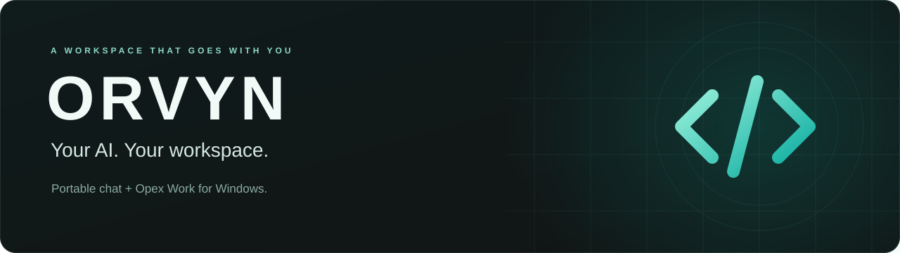
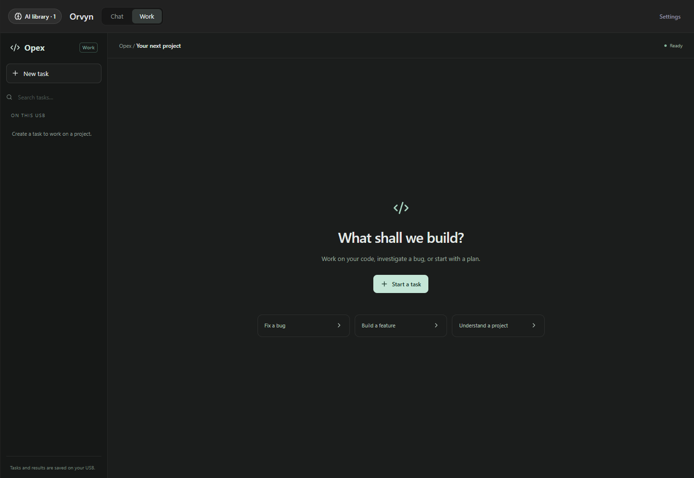

<p align="center">
  <a href="#quick-start" aria-label="Get started with Orvyn">
    
  </a>
</p>

<p align="center">
  <a href="https://github.com/draftiermovie/Orvyn/releases"></a>
  <a href="docs/GITHUB.md"></a>
  <a href="https://github.com/draftiermovie/Orvyn/issues"></a>
</p>

<br/>

<h1 align="center">Orvyn</h1>

<p align="center">Local AI chat and a coding workspace, together in one portable Windows app.</p>

<p align="center">
  <a href="https://github.com/draftiermovie/Orvyn/actions/workflows/ci.yml"></a>
  <a href="LICENSE"></a>
  
  
</p>

<br/>

Orvyn brings AI chat, model discovery, documents, and **Opex Work** into a workspace you can keep on a USB drive. Run supported local models or connect an OpenAI-compatible API, with presets for OpenAI, OpenRouter, Groq, DeepSeek, and Mistral AI. Conversations, configuration, models, and backups stay in the app folder; API requests send their supplied content to the selected provider.

## Features

- **Local chat and API connections** — use Orvyn 1, import a compatible GGUF model, or connect your preferred OpenAI-compatible provider.
- **AI model library** — discover Hugging Face GGUF models across Chat, Code, Reasoning, and Vision categories, with queued downloads and SHA-256 verification.
- **Opex Work** — browse a project, plan a task, review proposed changes, keep backups, and follow terminal output in a persistent task workspace.
- **Plan mode** — discuss an approach before executing actions. Agent work pauses after eight automatic steps.
- **Documents and sources** — import PDF, Word, Excel, text, and source files; ask questions using selected excerpts and view the sources supplied to the model.
- **Portable by design** — keep app data alongside the executable and move the folder between writable locations. Models unload after 30 minutes of inactivity.
- **English interface** — choose the response language and style in Settings, with startup diagnostics and experimental training reports available.
- **Rust + React** — a native Rust host with a React, TypeScript, and Tailwind interface inside Windows WebView2.

> [!NOTE]
> Orvyn is under active development. The model-library and English-language updates are in source; older packaged builds may not include them. Check the [release notes](docs/RELEASE-NOTES-0.7.0.md) and the source commit associated with a download.

> [!IMPORTANT]
> Opex file actions are restricted to the chosen USB project. Approved PowerShell commands run with your Windows account permissions and can access other locations. Review commands before approval; they have a 60-second time limit.



<p align="center"><sub>Opex Work — workspace preview from the browser integration tests.</sub></p>

## Quick start

### Run a packaged build

Check [Releases](https://github.com/draftiermovie/Orvyn/releases) for published builds. Orvyn requires **64-bit Windows 10/11** and the **Microsoft Edge WebView2 Runtime**.

| Package | What is included | Getting started |
| --- | --- | --- |
| Standard | Orvyn 1 and its inference runtime | Run the installer, then open `Orvyn.exe`. |
| Without Orvyn 1 | App and runtime, without bundled model weights | Connect an API or download a compatible model. |
| Portable folder | Files kept together in a movable folder | Open `Orvyn.exe` or the packaged `START.bat`. |

For locally built 0.7.0 installers, the filenames are `Orvyn-Setup-0.7.0.exe` and `Orvyn-Setup-0.7.0-No-Orvyn-1.exe`. Keep the portable folder together: model weights and runtime files sit beside the executable rather than inside it. Updates preserve existing user configuration and conversations; uninstalling preserves user data and models.

### Build from source

Install Git, Node.js 22, Rust with the MSVC target, and Visual Studio's **Desktop development with C++** workload with a Windows SDK. Rust 1.97.1 is the version selected in CI.

```powershell
git clone https://github.com/draftiermovie/Orvyn.git
cd Orvyn
.\scripts\initialize-config.ps1
. .\scripts\usb-environment.ps1
Push-Location apps/web-ui
npm ci
Pop-Location
.\scripts\build-ui.ps1
.\scripts\prepare-cargo-cache.ps1
.\scripts\build-desktop.ps1
.\scripts\deploy-desktop.ps1
.\dist\AI-USB.exe
```

The source repository excludes model weights and the inference runtime. Connect an API to begin, or supply the local runtime and a compatible model as described in the [development guide](docs/DEVELOPMENT.md). Initial dependency setup needs internet access; native builds and tests then use the locked offline cache.

## Documentation

| Guide | Contents |
| --- | --- |
| [Development and packaging](docs/DEVELOPMENT.md) | Prerequisites, source layout, local checks, portable packages, and installers |
| [Workspace features](docs/workspace-features.md) | Models, documents, sources, speech, and preferences |
| [Opex PC access](docs/OPEX-PC.txt) | Project boundaries, approvals, commands, and backups |
| [Orvyn 1](docs/ORVYN-1.md) | Base model, profile settings, website excerpts, and performance notes |
| [GitHub Actions and issues](docs/GITHUB.md) | CI jobs, issue forms, and contribution workflow |
| [Improvement backlog](docs/ISSUE-BACKLOG.md) | Ready-to-file issue drafts and acceptance criteria |
| [Release notes](docs/RELEASE-NOTES-0.7.0.md) | Source changes and package verification status |

## License and attribution

Orvyn application source and documentation are offered under the custom **[Orvyn Free Redistribution License 1.0](LICENSE)**. You may use and modify covered material, and share copies **free of charge**. Selling copies, charging for downloads, or bundling covered material into paid distributions requires separate written permission. See the [licensing guide](docs/LICENSING.md), including the continuing rights for earlier MIT releases.

**Orvyn 1** is an assistant profile based on **Llama 3.2 1B Instruct Q4_K_M**, not a newly trained foundation model. **Built with Llama.** Model weights, llamafile, and other dependencies retain their own licenses and notices. The Orvyn license does not replace the Llama license or acceptable-use policy; keep the [bundled third-party notices](apps/manager/packaging/licenses) when redistributing relevant components. Experimental training candidates are not activated automatically.

## Support and contributing

- [Report a bug](https://github.com/draftiermovie/Orvyn/issues/new?template=bug-report.yml) with your version, reproduction steps, and redacted logs.
- [Suggest a feature](https://github.com/draftiermovie/Orvyn/issues/new?template=feature-request.yml) with the problem it solves and clear acceptance criteria.
- [Review the backlog](docs/ISSUE-BACKLOG.md) or open a pull request. Describe the change and the checks you ran.
- **Star the repository** to help others discover Orvyn.

Keep API keys, personal conversations, model weights, and local configuration out of issues and commits.
